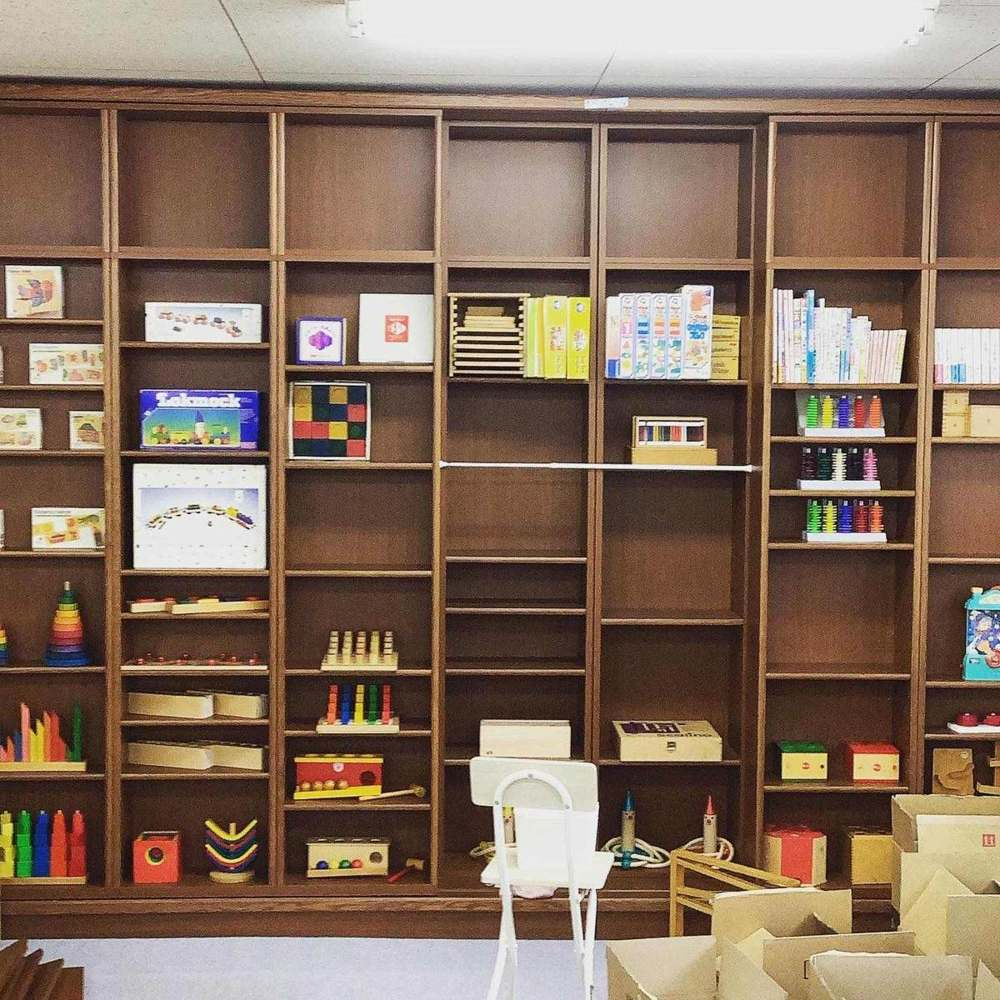
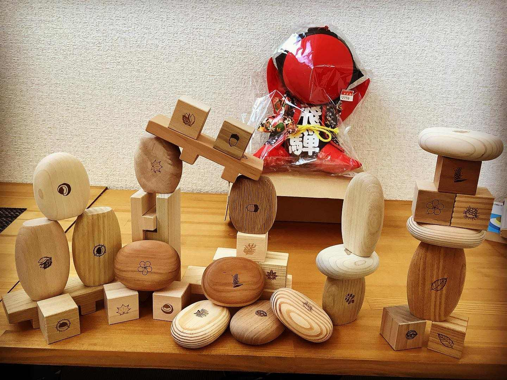
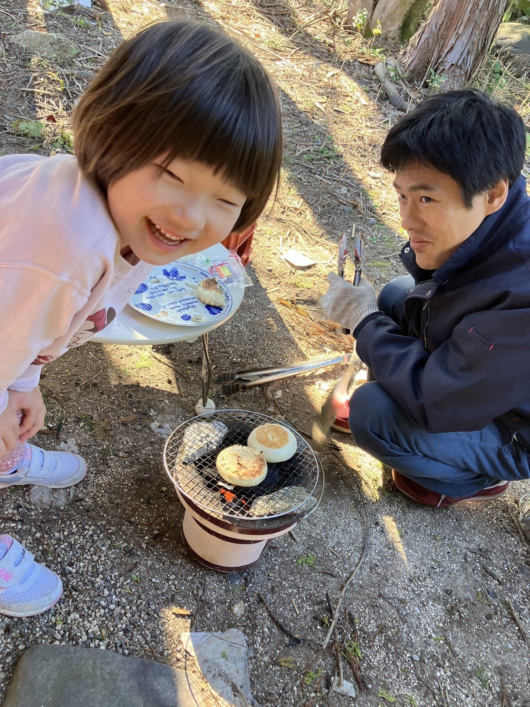
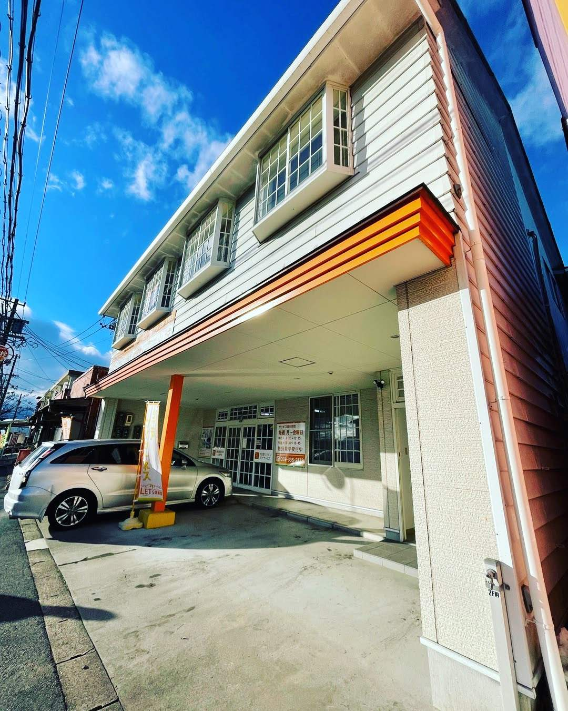

# レオ

ここを書き換えると、サイトに反映されます

## 見出し

おもちゃ、武道、

庭いじりで整えます。

## リード文

体を動かし、手を動かします。

情緒は、遊びの中で整えます。

## 本文

- 日常生活に必要な動作の指導をしたり、人や物を通して情緒の安定を図ったりします。
- 集団療育をしています。 １部：11:00～14:30 ２部：放課後～17:00
- 昼食を提供します。（１回３００円） 手作りの和食で情緒を養います。
- 対象年齢は、満１歳から小学校に上がるまでのお子様です。
- 主に発達障害のお子様をお預かりします。
- 地域によっては、送迎のご相談も承ります。

たくさんのおもちゃの中から、自分の好きなものを見つけたり、一緒に少し難しいものにもチャレンジしたりします。（「認知・行動」「言語・コミュニケーション」「人間関係・社会性」）

武道やヨガ、農作業を通じて心身を鍛えます（「健康・生活」「運動・感覚」）。格闘家や農家さんのところへ行き**地域連携**を行なっています。

### 【行事】

菰野町のフィールドにお出かけして、遊びながら自然観察をしたり、七輪で火を起こしをしたりします。

### 家族支援・進路相談（移行支援）

※経験豊富な加藤が当事業所の研修講師も担当し、職員の質の向上に取り組んでいます。

建物の２階です。看板のあるドアからお入りください。

### 令和7年度　事業所評価の公表

- [保護者評価（児発）](https://drive.google.com/file/d/14OypM0APjAh34RtH2quEMIqe6ip6Ho5H/view)
- [保護者評価（放デイ）](https://drive.google.com/file/d/10l7_-n_o4skBCgxZ35YOSQEhlD7Fy_v7/view)
- [従業員評価（児発）](https://drive.google.com/file/d/1YD2ecQgUOtg6cIQg5aTGtEEMQ-LCjVE8/view)
- [従業員評価（放デイ）](https://drive.google.com/file/d/1yrSP-dmLRmtEHtutC6_cvXlzKXXN80FP/view)
- [総括表（児発）](https://drive.google.com/file/d/17myXyFuwv6h46gbrnSeM-U_HvjDwzRTm/view)
- [総括表（放デイ）](https://drive.google.com/file/d/1WEtF9XmGiatfKcp-scK35GLzyXfzONWJ/view)

## 対象・費用・場所

### 対象

落ち着かない、こだわりが強い、集団が苦手なお子さま。診断の有無は問いません【要確認：対象年齢の表記】

### 時間

1部 11:00〜14:30／2部 放課後〜17:00

### 昼食

1回300円

### 場所

三重県四日市市あさけが丘2-1-42

三岐線 山城駅から徒歩12分

名古屋西ICから車で約30分

建物の2階

### 送迎

地域により相談可

### 費用

公的制度の利用可（自治体の手続きが必要。こちらで案内）

## よくある質問

### 診断がなくてもいいですか？

かまいません。診断の有無は問いません。今の困りごとから始めます。

### 病院に行ったことがないのですが。

問題ありません。精神科に通ったことがあるかどうかは前提にしていません。

### 何をしてくれるのですか？

体を動かし、手を動かします。情緒は、遊びの中で整えます。

### 手続きが難しそうです。

書類と手続きはこちらで進めます。知識は要りません。

### いくらかかりますか？

公的制度を使います。所得に応じた負担上限があり、多くは自己負担なしか低額です。金額は初回連絡でお示しします。

### 送迎はありますか？

地域によって相談を受けます。

### 昼食は？

手作りの和食を1回300円で提供します。

### 保護者向けの支援は？

ペアレントトレーニングと発達検査を行っています。
