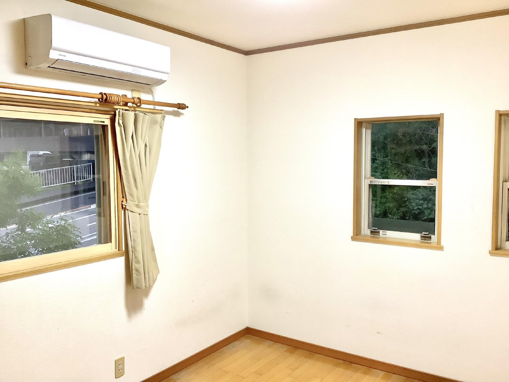
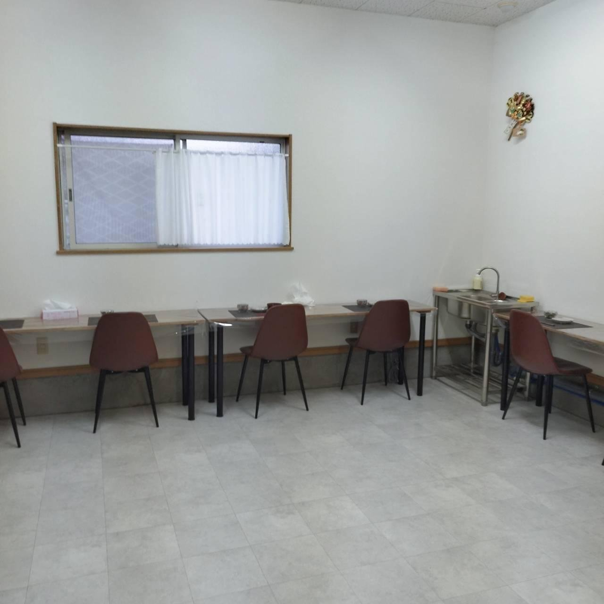
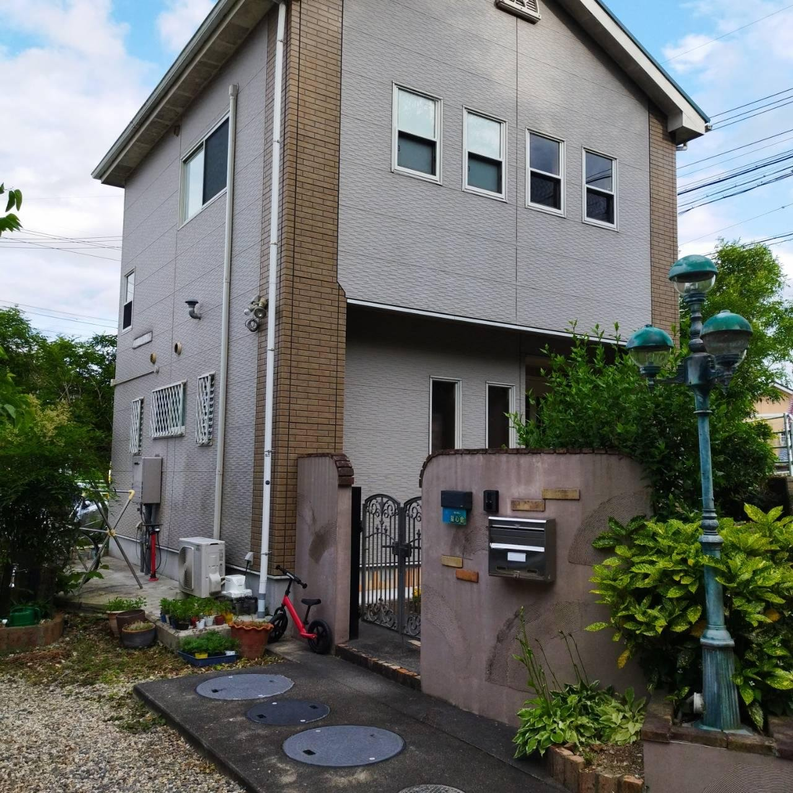

## メンタルピアレジデンス

# 梁山泊（りょうざんぱく）

ここを書き換えると、サイトに反映されます

## 見出し

障害者雇用（精神）で働く人のためのシェアハウス。朝夕食事付き。

## リード文

## 本文

### 家賃・部屋数

#### 家賃

家賃 月8万円（朝夕食事付き）

### 場所

三重県四日市市山城町59-4

三岐線 山城駅から徒歩5分

名古屋西ICから車で約30分

三岐バス「団地下」 徒歩30秒

マックスバリュ（7〜23時営業） 徒歩1分

クスリのアオキ 徒歩3分

ローソン 徒歩7分

### 部屋・建物の様子

居室（6畳・クローゼット付き）

食堂

建物の外観

